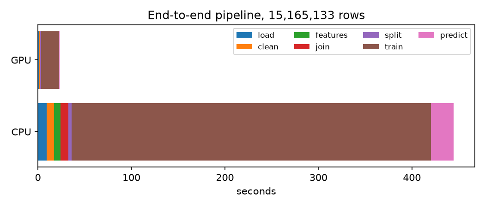

# CPU vs GPU: end-to-end analytics on NYC taxi data

**On the same Google Colab machine, NVIDIA RAPIDS ran the full pipeline 17.3× faster than pandas + scikit-learn on 7.3M taxi trips (201.0 s vs 11.6 s), with matching ROC-AUC (0.6269 vs 0.6260).**

The same data-science pipeline runs on two stacks, and every stage is timed:

| Stage | CPU stack | GPU stack (NVIDIA RAPIDS) |
|---|---|---|
| Load parquet | pandas | cuDF |
| Clean, feature engineering, group-by, joins | pandas | cuDF |
| Train/test split, metrics | scikit-learn | cuML |
| Model | XGBoost `device="cpu"` | XGBoost `device="cuda"` |

**Task:** predict whether a card-paid yellow-cab trip gets a tip of at least 20% of the fare.
**Data:** [NYC TLC trip records](https://www.nyc.gov/site/tlc/about/tlc-trip-record-data.page), 2023: January (2.38M trips after cleaning) and January to March (7.33M trips after cleaning).

## Results

Times in seconds. The total also includes the train/test split stage.

| rows | backend | load | clean | features | join | train | predict | total (s) | ROC-AUC | speedup |
|---|---|---|---|---|---|---|---|---|---|---|
| 2,384,701 | cpu | 1.064 | 0.919 | 0.686 | 0.919 | 52.871 | 3.428 | 60.264 | 0.6227 | 1.0x |
| 2,384,701 | gpu | 0.59 | 0.193 | 0.12 | 0.109 | 3.587 | 0.087 | 4.791 | 0.6261 | 12.6x |
| 7,330,190 | cpu | 4.229 | 3.639 | 2.351 | 3.658 | 173.414 | 12.025 | 201.039 | 0.6269 | 1.0x |
| 7,330,190 | gpu | 0.967 | 0.286 | 0.194 | 0.196 | 9.441 | 0.165 | 11.627 | 0.626 | 17.3x |



**Hardware:** Google Colab, NVIDIA Tesla T4 (15.6 GB) vs Intel Xeon @ 2.00 GHz (2 cores), same machine.
**Software:** cuDF 26.06.00, cuML 26.06.00, XGBoost 3.4.1, pandas 2.2.3, scikit-learn 1.6.1.
**Method:** each configuration was run twice; the table shows the second (warm) run. Raw timings for every run are in [`results/runs.jsonl`](results/runs.jsonl).

## Findings

- **The speedup grows with data size: 12.6× at 2.4M rows, 17.3× at 7.3M rows.** For about 3.1× more rows, CPU time grew 3.3× but GPU time grew only 2.4×, because the GPU's fixed costs are spread over more work.
- **Training dominates, and gains a lot.** XGBoost training was 86–88% of CPU time and ran 14.7× faster on the GPU at 2.4M rows and 18.4× faster at 7.3M rows.
- **Data stages gain most once the data is large enough.** Joins went from 8.4× to 18.7× faster and cleaning from 4.8× to 12.7×. Loading gained least (1.8× and 4.4×), because reading Parquet is limited by the disk rather than by compute.
- **Warm-up matters.** The first GPU run of the session took 11.0 s and the second 4.8 s, so more than half of the cold run was one-time startup cost. At 3 months, both GPU runs took 11.6 s, which suggests that cost is paid once per session.
- **Accuracy matched.** CPU ROC-AUC was identical across runs; GPU ROC-AUC varied slightly between runs (0.6247 and 0.6261 at 1 month, 0.6264 and 0.6260 at 3 months). The likely cause is that the GPU join returns rows in a different order, which changes the test split. At 7.3M rows, the CPU-GPU gap was 0.001.

## Limitations

- The CPU baseline is a 2-core cloud machine; a many-core CPU would narrow the gap.
- One warm run per configuration, not a median of repeats.
- Two data sizes (1 and 3 months).
- The model is deliberately simple (ROC-AUC about 0.63). This project measures speed, not prediction quality.

## Reproduce

```bash
pip install -r requirements.txt           # CPU
python src/benchmark.py --backend cpu --months 2023-01 2023-02 2023-03
python src/report.py
```
For the GPU backend, see [notebooks/run_on_colab.md](notebooks/run_on_colab.md) (free T4). Run each command twice and keep the second run, as in the results above.

## Related

Part 1, writing the kernels by hand (naive CUDA, tiled shared-memory and cuBLAS matrix multiply): [Image-processing-kernels-with-CUDA-CPU-and-GPU-](https://github.com/rafayelmirijanyan1997/Image-processing-kernels-with-CUDA-CPU-and-GPU-)

## Author

Rafayel Mirijanyan
